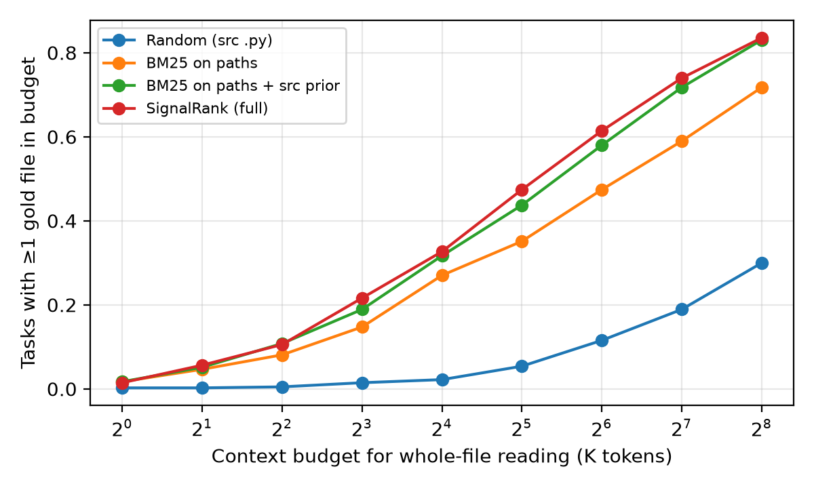

# Ranking Is Not the Bottleneck: LLM-Free Localization for Small Coding Agents

**Subtitle:** A zero-download, zero-GPU localizer for SWE-bench, and evidence that a small agent is limited by how much of each file it can read, not by which file it picks

---

## Abstract

Coding agents built on small local models, such as the Gemma 4 family running on a single accelerator, have to find the code to change inside repositories that hold millions of tokens of Python. Most localization methods use the same LLM, embeddings or a full checkout, and all of these spend the small agent's scarce compute and context. We ask how far one can get with **no model, no clone and no file contents**, using only the issue text and the repository's file tree with file sizes, which one GitHub API call returns. We present **SignalRank**, a deterministic localizer with three parts: (1) explicit issue signals (traceback frames, file paths, dotted module paths) resolved against the tree; (2) BM25 over identifier-split path tokens; (3) a source-file prior that drops tests, docs and examples. On SWE-bench Lite (300 tasks), SignalRank puts a gold file first for **29.0%** of tasks and in the top 5 for **49.3%**. Random picks give 0.0% and 2.0%. On a **held-out set of 407 SWE-bench Verified tasks** that do not overlap with Lite, it reaches **32.7% Hit@1** and **52.6% Hit@5**. That is +12.0 points Hit@1 over the strongest single baseline (paired bootstrap 95% CI [+7.9, +16.5]). The design was frozen before the held-out set was evaluated. Our main finding is a **budget gap**. Gold files have a median size of about 7.4K–7.9K tokens, and about half are larger than 8K. Because of this, a +12-point ranking gain becomes only a +2.7-point gain when the agent has to fit whole files into an 8K-token budget. Explicit signals solve file selection for the ~60% of issues that contain them. After that, a small agent's main limit is reading *inside* files, not choosing files. We release all code. It runs on a laptop in under two minutes.

---

## 1. Introduction

SWE-bench [1] has become the standard test for agentic software engineering: given a GitHub issue and a repository at a fixed commit, write a patch that passes hidden tests. Strong systems [2, 3, 4] start by **localizing** the bug: deciding which files and functions to edit. For a small local model, localization is the expensive part: every file opened costs context, every exploratory tool call costs latency, and a wrong first guess can use up the window before editing begins.

This paper studies localization from the point of view of a **small-context agent**. Two questions guide it:

- **RQ1. How much localization signal is in the issue text and the file tree alone?** If a deterministic pre-step can rank files well, the small model can spend its whole budget on understanding and editing.
- **RQ2. Does better file ranking actually help when context is limited?** Standard metrics (Acc@k, Recall@k) count files and treat a 300-token file the same as a 30,000-token one. A small model pays for tokens, not files.

Our contributions are:

1. **SignalRank**, a localizer that needs no LLM, no embeddings, no clone and no file contents. It needs one GitHub tree API call per task, runs on CPU in milliseconds per task, and is fully deterministic.
2. A **signal audit** of SWE-bench issues: what share contain tracebacks, explicit paths or module names, and how well each kind localizes.
3. A **budget-aware metric**, *Budget@B*: the share of tasks where the agent reaches a gold file before the cumulative token cost of the files it has read so far exceeds B. Using it, we show that ranking gains shrink sharply at small-model budgets.
4. A **held-out validation protocol**: we design on SWE-bench Lite, then evaluate once on the SWE-bench Verified tasks that are not in Lite. This guards against the benchmark overfitting that hand-built heuristics are prone to.

## 2. Related Work

**Repository-level SWE benchmarks.** SWE-bench [1] collects 2,294 issue/PR pairs from 12 Python repositories; Lite is a 300-task single-file subset, and Verified [5] is a 500-task human-validated subset.

**Agentic and agentless localization.** SWE-agent [2] lets an LLM navigate with shell-like tools. AutoCodeRover [3] adds AST-aware code search APIs. Agentless [4] localizes hierarchically: an LLM reads a compressed repository tree to pick files, then classes or functions, then edit locations. It reports that file-level localization is a large share of overall success. LocAgent [6] lets the LLM traverse a code graph. All of these call an LLM while localizing. SignalRank is a *pre-filter* that comes before any of them and costs no model calls.

**Lexical retrieval.** BM25 [7] remains a strong baseline for code retrieval, and the SWE-bench authors used BM25 over file *contents* for their retrieval setting [1]. Reciprocal Rank Fusion (RRF) [8] is a standard way to combine rankers. We find that BM25 over *paths alone* is surprisingly competitive, and that naive fusion with an identifier matcher *hurts* (Section 5.2).

**Long context.** Models use mid-context information less reliably [9], which makes loading whole files even costlier for small models.

## 3. Method: SignalRank

**Inputs.** The issue text *q*, and the list of `(path, size_bytes)` pairs from `GET /repos/{owner}/{repo}/git/trees/{base_commit}?recursive=1`. No file contents are used.

**Stage 1: explicit signals (ordered tier).** We extract three kinds of mention with regular expressions:

- *Traceback frames* (`File ".../x.py", line N`), **innermost frame first**.
- *File paths* ending in `.py` (absolute, relative, or site-packages paths).
- *Dotted module paths* (for example `django.db.models.query.QuerySet`), resolved by taking the longest prefix that maps to a module file or a package `__init__.py`.

Each mention is resolved against the tree by **suffix matching**. We try the longest path suffix first and accept a match if the suffix has at least two components or matches exactly one file. This handles paths like `/usr/lib/python3/site-packages/sympy/core/expr.py` → `sympy/core/expr.py`. Resolved files form the head of the ranking, in mention order. Mentioned files that the Stage 3 prior would remove are moved to the end of the tier rather than dropped.

**Stage 2: path BM25.** Every remaining candidate becomes a short document made from its identifier-split path components: `camelCase` and `snake_case` are split, and the basename stem is counted twice. We score these documents against the identifier-split issue text with BM25 (Okapi, default parameters).

**Stage 3: source-file prior.** Candidates are limited to `.py` files outside tests (`tests/`, `test_*.py`, `*_test.py`, `conftest.py`) and documentation or example trees (`docs/`, `examples/`, `benchmarks/`, `asv_bench/`). SWE-bench separates the gold code patch from the test patch, so test files are almost never gold. The same is true in real maintenance workflows.

**Output.** The final ranking is the Stage 1 tier followed by the Stage 2 BM25 ranking over the Stage 3 candidates, without duplicates. Stage 1 matching uses simple loops over the tree; Stage 2 scoring takes milliseconds per task on a laptop CPU.

**What we tried and dropped.** We also built an identifier matcher. It extracts backticked spans, CamelCase and snake_case tokens from the issue and scores path components, giving three times the weight to matches on the file stem. We combined it with BM25 using RRF (k = 60). Section 5.2 shows that this *lowered* accuracy, so the final system does not use it. We report it as a negative result.

## 4. Experimental Setup

**Data.** *Development:* SWE-bench Lite test split, 300 tasks from 12 repositories. All its gold patches touch exactly one file. *Held-out:* SWE-bench Verified with every instance that also appears in Lite removed, leaving **407 tasks**. 17.4% of these have multi-file gold patches. Gold files are the files that appear in the `diff --git` headers of the reference patch. Both datasets come from the HuggingFace Hub (`princeton-nlp/SWE-bench_Lite`, `princeton-nlp/SWE-bench_Verified`).

**Protocol.** We designed and ablated all components on Lite. We then evaluated the frozen configuration, together with every baseline and ablation, on the held-out set. We did not tune anything on held-out data. The only change after the first held-out run was making the random baseline's seed deterministic; this does not affect any other method.

**Metrics.**

- *Hit@k*: at least one gold file in the top k.
- *All@k*: every gold file in the top k (differs from Hit@k only on multi-file tasks).
- *MRR*: mean reciprocal rank of the first gold file.
- ***Budget@B*** (new): the agent reads ranked files *in full*, in order. Budget@B is the share of tasks where it reaches a gold file before the cumulative token cost exceeds B. Token cost is estimated as bytes / 3.5, a typical ratio for Python source under subword tokenizers. A different constant shifts the budget axis but not the ranking of methods.

**Baselines.** Random order over source `.py` files; BM25 over paths with and without the source prior; the identifier matcher; RRF(BM25, identifier).

**Statistics.** Paired bootstrap over tasks (10,000 resamples, seed 0) for the difference between SignalRank and the strongest baseline.

## 5. Results

### 5.1 Main results

**Table 1. File localization. Development split = SWE-bench Lite (n = 300); held-out split = Verified \ Lite (n = 407).**

| Method | Lite Hit@1 | Lite Hit@5 | Lite Hit@10 | Lite MRR | **Held-out Hit@1** | **Held-out Hit@5** | **Held-out Hit@10** | Held-out All@10 | Held-out MRR |
|---|---|---|---|---|---|---|---|---|---|
| Random (source .py) | 0.000 | 0.020 | 0.043 | 0.020 | 0.010 | 0.044 | 0.069 | 0.044 | 0.036 |
| BM25 on paths | 0.103 | 0.277 | 0.347 | 0.185 | 0.135 | 0.307 | 0.396 | 0.334 | 0.220 |
| BM25 on paths + source prior | 0.157 | 0.427 | 0.520 | 0.278 | 0.206 | 0.455 | 0.541 | 0.469 | 0.330 |
| Identifier match + prior | 0.087 | 0.187 | 0.213 | 0.135 | 0.106 | 0.224 | 0.273 | 0.224 | 0.163 |
| RRF(BM25, identifier) + prior | 0.103 | 0.230 | 0.303 | 0.179 | 0.115 | 0.260 | 0.359 | 0.300 | 0.204 |
| **SignalRank (full)** | **0.290** | **0.493** | **0.540** | **0.383** | **0.327** | **0.526** | **0.592** | **0.511** | **0.422** |

SignalRank improves on the strongest single baseline (BM25 + prior) on both splits. On held-out data the paired bootstrap differences are **+12.0 Hit@1 [95% CI +7.9, +16.5]**, **+7.1 Hit@5 [+4.2, +10.3]** and **+5.2 Hit@10 [+2.9, +7.4]**. On Lite they are +13.3 [+8.3, +18.7], +6.7 [+4.0, +9.7] and +2.0 [0.0, +4.0]. Held-out scores are slightly *higher* than development scores, so we see no sign that the hand-designed rules overfit Lite.

LLM-based localizers such as Agentless [4] report higher file-level accuracy. SignalRank does not compete with them; it is free and can feed them, replacing the compressed repository tree in their prompt with a top-10 list.

### 5.2 Ablations

**Table 2. Ablations (Hit@1 / Hit@5 / MRR).**

| Variant | Lite | Held-out |
|---|---|---|
| SignalRank (full) | 0.290 / 0.493 / 0.383 | 0.327 / 0.526 / 0.422 |
| − source prior | 0.267 / 0.407 / 0.337 | 0.297 / 0.455 / 0.372 |
| BM25 replaced by RRF(BM25, identifier) | 0.277 / 0.420 / 0.348 | 0.302 / 0.455 / 0.377 |
| − explicit tier (= BM25 + prior) | 0.157 / 0.427 / 0.278 | 0.206 / 0.455 / 0.330 |

Three findings hold on both splits:

- **The explicit tier drives Hit@1** (+12–13 points).
- **The source prior drives Hit@5** (+7–9 points). Without it, test files that share vocabulary with the issue (`tests/test_query.py` for a QuerySet bug) crowd the top ranks.
- **Identifier fusion hurts** (−7 Hit@5 on both splits). Issue identifiers such as `QuerySet`, `Expr` and `fit_transform` name *concepts* that appear across many path components. Path-level matching cannot tell the defining module from its many users, and RRF gives this noisy ranker the same weight as BM25. The lesson for small-agent pipelines is that more lexical signals are not automatically better; each one should be validated on its own before fusing.

### 5.3 Signal audit: what do issues tell you?

**Table 3. Issues grouped by their strongest explicit signal, with SignalRank Hit@1 per group.**

| Strongest explicit signal | Lite share | Lite Hit@1 | Held-out share | Held-out Hit@1 |
|---|---|---|---|---|
| Traceback frame | 16.0% (48) | 0.583 | 9.6% (39) | 0.538 |
| File path or module path | 41.0% (123) | 0.382 | 46.4% (189) | 0.471 |
| None | 43.0% (129) | 0.093 | 44.0% (179) | 0.128 |

About **56–57% of issues contain an explicit file-level signal**, and in **31.7% (Lite) / 34.4% (held-out)** of all issues, one of the explicitly mentioned files *is* a gold file. Tracebacks are the most precise signal, but even there SignalRank's top-1 pick (usually the innermost resolvable frame) is gold only 54–58% of the time. The fix often belongs in a caller, or in library code that the frame passes through. The **no-signal group (~43–44%) is where path-only methods fail** (Hit@1 9–13%). Concept-only issues need content- or graph-level search; that is where a small agent should spend its LLM calls.

### 5.4 The budget gap

Repositories in both splits hold a median of **~3.9–4.0M tokens** of Python (range 0.10M–9.1M), far more than any single-accelerator context window. More importantly for localization, **gold files are large**: median 7.9K tokens (Lite) / 7.4K (held-out), 90th percentile 28K / 27K, with **47–50% larger than 8K tokens** and ~6% larger than 32K. Large central modules such as `django/db/models/query.py` attract many bugs.

**Table 4. Budget@B: share of tasks whose first gold file is reached within B tokens of whole-file reading.**

| Method | Lite 8K | Lite 32K | Lite 128K | Held-out 8K | Held-out 32K | Held-out 128K |
|---|---|---|---|---|---|---|
| Random | 0.007 | 0.027 | 0.123 | 0.015 | 0.054 | 0.189 |
| BM25 + prior | 0.150 | 0.387 | 0.677 | 0.189 | 0.437 | 0.717 |
| **SignalRank** | **0.210** | **0.410** | **0.680** | **0.216** | **0.474** | **0.740** |

*Figure 1. Held-out Budget@B for budgets from 1K to 256K tokens.*

On held-out data, SignalRank's **+12.0-point Hit@1 advantage shrinks to +2.7 points at 8K, +3.7 at 32K and +2.3 at 128K**. The reason is simple. Even with a perfect top-1, half of gold files do not fit in 8K tokens, so the best possible Budget@8K for any file-level ranker is roughly the share of gold files under 8K. Better ranking cannot raise that ceiling. **For small-context agents, the bottleneck after explicit-signal localization is reading inside a file, not choosing a file.**

This leads to a concrete design recommendation for Gemma-class agents:

1. Use a zero-cost file ranker such as SignalRank to pick candidate files.
2. Do **not** load candidate files whole. Load *skeletons* instead (class and function signatures only) and expand only the functions the model asks for.
3. Spend LLM calls mainly on the ~44% of issues with no explicit signal.

Agentless's skeleton representation [4] is in this spirit; our data shows it is a requirement, not just a saving, at small budgets.

## 6. Limitations

- **File level only.** We measure file localization, not function localization or end-to-end resolution. We did not run a Gemma model end to end, so we make no claim about resolve-rate gains. The budget analysis models a specific reading policy (whole files, in rank order).
- **Token estimate.** Token counts are estimated from bytes (÷3.5), not from a specific tokenizer.
- **Python-only and benchmark-specific.** SWE-bench covers 12 Python repositories. Issues there may contain more tracebacks and module paths than issues in other ecosystems. The suffix-matching and dotted-path rules port directly to Java and Go; the source prior's directory names need adapting.
- **Hand-designed rules.** The rules were designed on Lite. The held-out protocol reduces, but does not remove, the chance of benchmark-specific choices.

## 7. Conclusion

A deterministic localizer that sees only the issue and the file tree finds a gold file first for about a third of SWE-bench tasks and in the top 5 for about half. It needs no GPU, no clone and no model call, which makes it a free first step for small local coding agents. The same experiments show that file ranking is not where small agents lose most. Gold files are often too large to read whole within a small model's budget. Progress for single-accelerator agents should therefore come from **reading inside files under a budget**: skeletons, function-level slicing and graph expansion. We release the code and per-split results so others can add their localizers to the same budget-aware evaluation.

## Reproducibility

All code is in the attached project, and it uses Python with the `pandas`, `pyarrow`, `huggingface_hub`, `rank_bm25` and `matplotlib` packages. `code/fetch_data.py [lite|heldout]` downloads the tasks and fetches 297 and 698 file trees (one GitHub API call each, authenticated). `code/localize.py [lite|heldout]` reproduces every number in this paper and writes `results/<split>/results.json` and `budget_curve.png`. The pipeline is deterministic, including the random baseline (seeded by CRC32 of the issue text) and the bootstrap (seed 0). End-to-end runtime is under 2 minutes on a laptop CPU after the data is fetched.

## References

[1] C. E. Jimenez, J. Yang, A. Wettig, S. Yao, K. Pei, O. Press, K. Narasimhan. *SWE-bench: Can Language Models Resolve Real-World GitHub Issues?* ICLR 2024.
[2] J. Yang, C. E. Jimenez, A. Wettig, K. Lieret, S. Yao, K. Narasimhan, O. Press. *SWE-agent: Agent-Computer Interfaces Enable Automated Software Engineering.* NeurIPS 2024.
[3] Y. Zhang, H. Ruan, Z. Fan, A. Roychoudhury. *AutoCodeRover: Autonomous Program Improvement.* ISSTA 2024.
[4] C. S. Xia, Y. Deng, S. Dunn, L. Zhang. *Agentless: Demystifying LLM-based Software Engineering Agents.* arXiv:2407.01489, 2024.
[5] N. Chowdhury et al. *Introducing SWE-bench Verified.* OpenAI, 2024.
[6] Z. Chen et al. *LocAgent: Graph-Guided LLM Agents for Code Localization.* ACL 2025.
[7] S. Robertson, H. Zaragoza. *The Probabilistic Relevance Framework: BM25 and Beyond.* Foundations and Trends in IR, 2009.
[8] G. V. Cormack, C. L. A. Clarke, S. Büttcher. *Reciprocal Rank Fusion Outperforms Condorcet and Individual Rank Learning Methods.* SIGIR 2009.
[9] N. F. Liu, K. Lin, J. Hewitt, A. Paranjape, M. Bevilacqua, F. Petroni, P. Liang. *Lost in the Middle: How Language Models Use Long Contexts.* TACL 2024.
